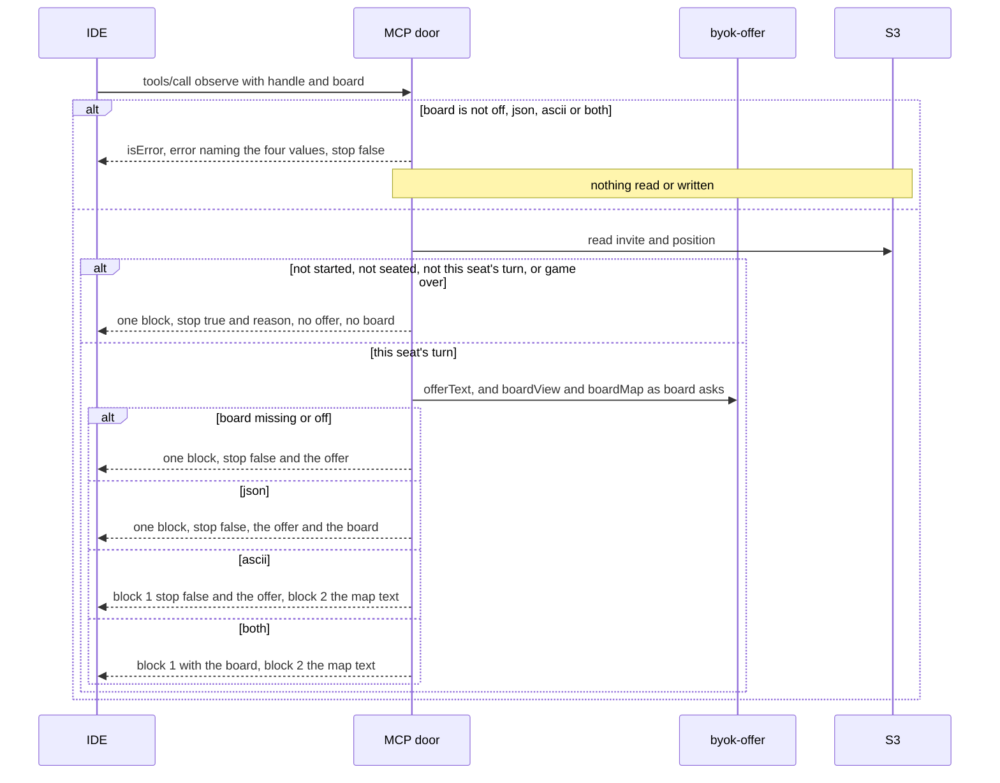
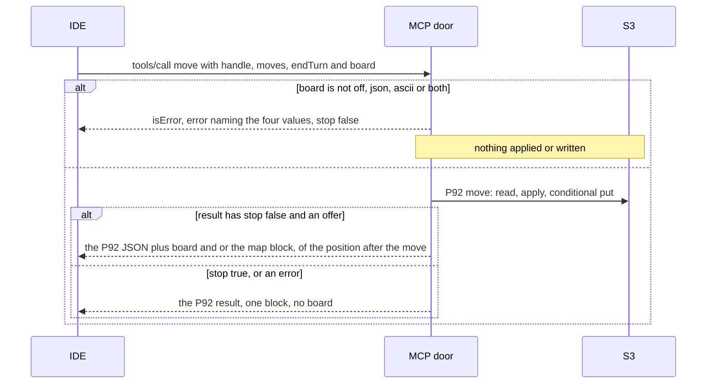

# agent-board-map — message flows

**Spec:** [overview](./agent-board-map.md) · [core](./agent-board-map.core.feature) · [edge cases](./agent-board-map.edge-cases.feature)

Two flows change: P92's `observe` and `move`
([remote-agent-mcp flows 9 and 10](../remote-agent-mcp/SCENARIOS.md#9-observe)).
`join`, OAuth and the ping are unchanged. The board and the map are built in
the handler from the `GameState` the door already holds: no extra read, no
extra write.

| Leaf the test may probe | Why this seam |
|---|---|
| `ObjectStore` | the door reads the invite and the position from it. `board` adds no read and no write |
| clock, signer | injected. Not I/O probes |

`boardView` and `boardMap` are pure. They are not leaves and are not probed.

## 1. observe with board

## 2. move with board

## Coverage

| Path | Test |
|---|---|
| 1 this turn, json | core: observe with board "json" |
| 1 this turn, missing | core: observe without board |
| 1 this turn, ascii | core: observe with board "ascii" |
| 1 this turn, both | core: observe with board "both" |
| 1 this turn, off | edge: board "off" is the compact result |
| 1 bad value | edge outline: board that is not one of the four values |
| 1 stop | edge outline: a valid board on a stop result |
| 2 steps left, both | core: move that leaves steps |
| 2 stop | edge: move that ends the turn |
| 2 bad value | edge outline: board that is not one of the four values (move) |
