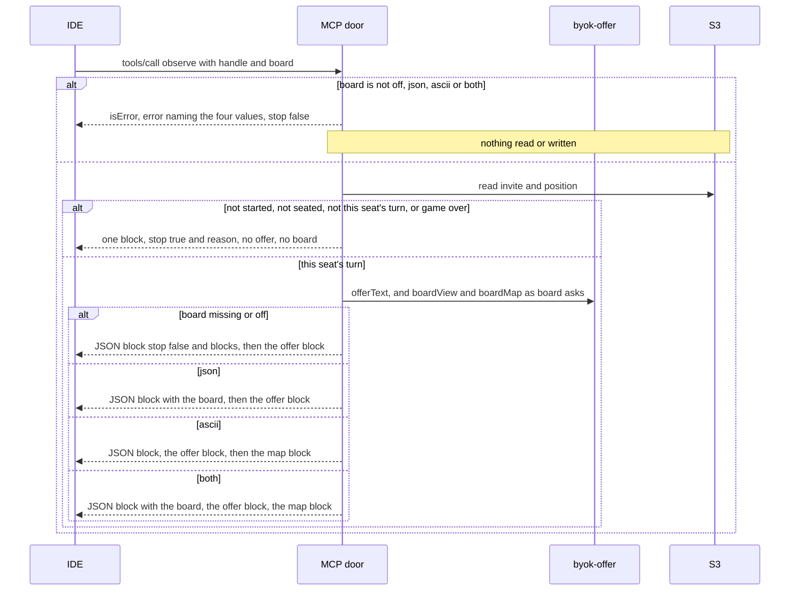
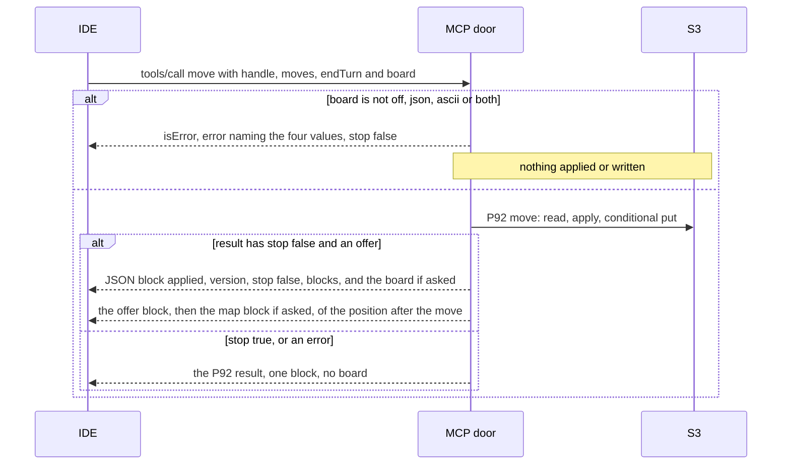

# agent-board-map — message flows

**Spec:** [overview](./agent-board-map.md) · [core](./agent-board-map.core.feature) · [edge cases](./agent-board-map.edge-cases.feature)

Two flows change: P92's `observe` and `move`. Every result that carries an
offer now sends it as its own plain-text block after a JSON block of machine
fields; `board` adds to that
([remote-agent-mcp flows 9 and 10](../remote-agent-mcp/SCENARIOS.md#9-observe)).
`join`, OAuth and the ping are unchanged. The board and the map are built in
the handler from the `GameState` the door already holds: no extra read, no
extra write.

| Leaf the test may probe | Why this seam |
|---|---|
| `ObjectStore` | the door reads the invite and the position from it. `board` adds no read and no write |
| clock, signer | injected. Not I/O probes |

`boardView` and `boardMap` are pure. They are not leaves and are not probed.

## 1. observe with board



## 2. move with board



## Coverage

| Path | Test |
|---|---|
| 1 this turn, json | core: observe with board "json" |
| 1 this turn, ascii | core: observe with board "ascii" |
| 1 this turn, both | core: observe with board "both" |
| 1 this turn, off | edge: board "off" is the compact result |
| 1 bad value | edge outline: board that is not one of the four values |
| 1 unknown tool | edge: an unknown tool with a valid board |
| 1 stop | edge outline: a valid board on a stop result |
| 1 this turn, offer block | core: observe without board returns the JSON block and the offer block |
| 2 steps left, offer block | core: move that leaves steps returns the machine fields and the new offer as text |
| 2 steps left, both | core: move with board "both" |
| 2 empty reply | edge: an empty reply returns the current offer as its own block |
| 2 stop | edge: move that ends the turn |
| 2 bad value | edge outline: board that is not one of the four values (move) |

## 3. BYOK seat-turn

```mermaid
sequenceDiagram
  participant Seat as web BYOK seat
  participant Ctx as byok-offer agentContext
  participant LLM as user's model
  Seat->>Ctx: first request of the seat-turn: prompt, state, seat, "ascii"
  Ctx-->>Seat: offer and map (boardView, boardMap)
  Seat->>LLM: system prompt with MAP_LEGEND; user: BOARD_MAP section, then the offer
  LLM-->>Seat: moves, endTurn false
  Seat->>Ctx: later request of the same seat-turn: prompt, "off"
  Ctx-->>Seat: offer only
  Seat->>LLM: user: the offer, with the plan echo
  LLM-->>Seat: moves, endTurn true
```

| Path | Test |
|---|---|
| 3 first request | core: the first request of a BYOK seat-turn carries the map |
| 3 later request | core: a later request in the same seat-turn sends the offer only |
| 1 and 3 same map | core: the door and the BYOK seat draw the same map |
