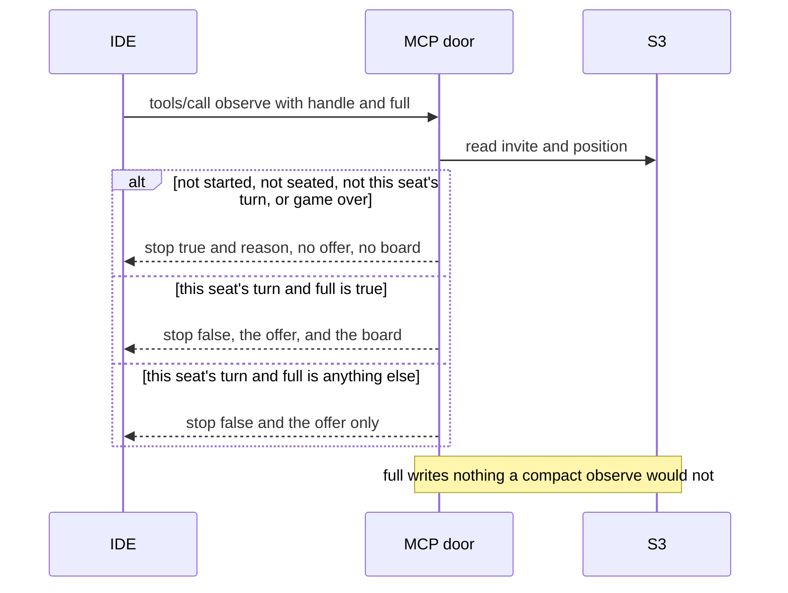

# agent-board-map — message flows

**Spec:** [overview](./agent-board-map.md) · [core](./agent-board-map.core.feature) · [edge cases](./agent-board-map.edge-cases.feature)

One flow changes: P92's `observe` ([remote-agent-mcp flow 9](../remote-agent-mcp/SCENARIOS.md#9-observe)).
`join`, `move`, OAuth and the ping are unchanged. The map is not a message:
it is drawn on the client from the board.

| Leaf the test may probe | Why this seam |
|---|---|
| `ObjectStore` | the door reads the invite and the position from it. `full` adds no write |
| clock, signer | injected. Not I/O probes |

The board is built inside the handler from the loaded `GameState` by the pure
`boardView`. It is not a leaf and is not probed.

## 1. observe with full

## Coverage

| Path | Test |
|---|---|
| 1 this turn, full true | core: full observe on the agent's turn |
| 1 this turn, no full | core: observe without full |
| 1 this turn, full not true | edge outline: full that is not the boolean true |
| 1 stop | edge outline: full true on a stop result |
