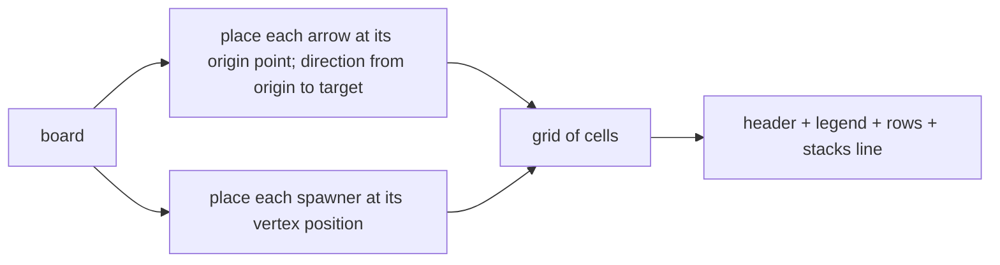

# agent-board-map — the whole board for the agent seat

**Packet:** [P93 — The agent can see the whole board](../../design/packets/P93-agent-board-map.md)
**Builds on:** [remote-agent-mcp](../remote-agent-mcp/remote-agent-mcp.md) (P92), [ADR 0009](../../adr/0009-remote-agent-mcp-seat.md).
**SPEC:** none. No game rule. Nothing is owed to SPEC §11.
**Features:** [core](./agent-board-map.core.feature) · [edge cases](./agent-board-map.edge-cases.feature) · [message flows](./SCENARIOS.md)

The P92 offer is built to be small. Territory is a count, spawners are capped
at 12 rows, trails are a 24-arrow sample. In the 2026-11-14 smoke test that
left the agent unable to see borders or the open spawners in the centre. This
feature adds an opt-in full board to `observe`, and a pure renderer that
draws a board as a text map.

## Terms

| Term | Means |
|---|---|
| **full observe** | `tools/call observe` with `full: true` (the JSON boolean). Any other value, or none, is the P92 observe |
| **board** | the `board` object a full observe adds beside `offer`. Ids, not counts. Defined below |
| **map** | the text `boardMap(board)` returns. Defined below |
| **point cell** | the 3 characters of the map that draw one point's three out-arrows |
| **vertex cell** | the 3 characters of the map between point cells, where spawners are drawn |
| **`pnpm board-map`** | the CLI. Reads a board, or an observe result carrying one, from a file argument or stdin. Prints the map |

## Where the code lives (BSSN)

- **`@conquarrow/byok-offer`** (`src/board.ts`): `boardView(geometry, state, me)`,
  `boardMap(board)`, `parseBoardView(json)`. Pure: no clock, no I/O. The
  group rows and spawner rows are the same helpers `snapshotForPrompt` uses,
  so a `board.groups` row and a `STATE_JSON.groups` row cannot drift apart.
- **MCP door** (`packages/online-api/src/mcp-door.ts`): `observe` reads
  `full` and adds `board`. Nothing else in the door changes.
- **CLI**: `scripts/board-map.mjs` (vite-node launcher, same shape as
  `pnpm bots`) and `scripts/board-map-run.ts` (read input, parse, print).
  No logic beyond I/O.

## The board

```json
{
  "me": "B",
  "players": ["A", "B", "C"],
  "activePlayer": "B",
  "territory": { "A": ["tiling:a:…"], "B": [], "C": ["…"] },
  "trails": { "A": [], "B": [], "C": ["…"] },
  "groups": [{ "arrow": "…", "owner": "C", "heads": 2, "spent": 0, "speed": 2 }],
  "spawners": [{ "vertex": "tiling:v:…", "force": "1/9", "held": { "B": 3 }, "unclaimed": 0 }]
}
```

- `territory` and `trails` have one key per seat in `players` order, each a
  list of arrow ids sorted ascending. A seat with none has `[]`. An owner
  that is not in `players` follows the seats, in id order, so no arrow is
  dropped.
- `groups` is every stack, in the `STATE_JSON.groups` row shape, sorted by
  arrow id (`speedOverride` only when set).
- `spawners` is every spawner on the board, sorted by vertex id. `held` maps
  a seat to how many of the 3 bordering arrows it holds as territory;
  `unclaimed` is the rest. Same row shape as `STATE_JSON.spawners`.
- On the agent's turn the observe result is `{ stop: false, offer, board }`.
  `offer` is the same text a compact observe returns.

## The map



Positions come from the generated tiling's layout (`makeLayout()`), the one
the browser draws:

- A point at layout position `(x, y)` sits at **row** `round(-2y)` and
  **column** `round(x / (√3/2))`. For tiling point `(i, j)` that is row
  `2i + j`, column `j`. Up on the screen is a larger row. Rows print top
  (largest) to bottom.
- Each column is 3 characters wide. A cell whose row and column have the same
  parity is a **point cell**; the other cells are **vertex cells**.
- A point cell draws that point's three out-arrows, ordered by where the
  arrow points on screen: **left** = down-left, **middle** = up, **right** =
  down-right. On the tiling those are `tiling:a:i,j,2`, `…,0`, `…,1`.
- An arrow's glyph: a stack's head count `1`–`9`, or `+` for 10 or more;
  else the trail owner's seat letter in upper case; else the territory
  owner's seat letter in lower case; else `.`. A stack wins over a trail, a
  trail over territory.
- A spawner sits in the vertex cell at its layout position, rounded the same
  way. Its glyph goes in the **left** character when its position is left of
  the column centre, the **right** when right. Middle is a space. `o` is
  open (no share held), `*` part held (1 or 2 shares held), `#` all held (3
  shares held, by one seat or several). A vertex cell with no spawner is
  spaces.
- The grid covers the smallest row and column range holding every listed
  arrow's origin point and every spawner. Point cells with no listed arrow
  print `...`.
- Output lines, in order: a header naming `me` and `activePlayer`; three
  legend lines; a column-label line; one line per row (`row` right-aligned
  in 3, a space, then the cells); then `stacks:` listing each stack as
  `<owner><heads> <arrow id>`, sorted by owner then arrow, joined by `; ` (`stacks: none` when there is none). Trailing spaces are
  trimmed. Lines end with `\n`.

A sample, from the smoke-test fixture, is the golden file
[`smoke-2026-11-14.map.txt`](../../../packages/byok-offer/test/fixtures/smoke-2026-11-14.map.txt).

## Decisions (BSSN)

Recorded in the [packet](../../design/packets/P93-agent-board-map.md#decisions-bssn-settled-with-the-human-2026-11-14):
opt-in on observe only; only literal `true`; no board on a stop; no summary
lines; the map is drawn on the client; tiling only. Two more made here:

- **`parseBoardView` is strict on shape.** It accepts a board, or an object
  with a `board` key holding one. It returns `undefined` for anything
  missing `me`, `players`, `territory`, `trails`, `groups` or `spawners`, or
  whose lists are not lists. The CLI prints a one-line error and exits 1.
- **The fixture is rebuilt, not copied.** The browser's export of the
  2026-11-14 game omits the heuristic seat's moves and the agent's
  `endTurn`s (backlog item). The fixture re-runs seat A with the production
  chooser, inserts the missing `endTurn`s, checks every move legal, and ends
  with B to move. It is a real, reachable position close to the human's
  screenshots, not a byte copy of the online log.

## Invariants

1. When `observe` has `full: true` on the agent's turn, the system shall list every territory arrow of the position exactly once, under its owner.
2. When `observe` has `full: true` on the agent's turn, the system shall list every trail arrow of every seat, with no sample cap.
3. When `observe` has `full: true` on the agent's turn, the system shall list every spawner, and for each one the held shares plus `unclaimed` shall equal 3.
4. When `observe` does not have `full: true`, the system shall return exactly the P92 result, with no `board` key.
5. The system shall render the same map for the same board, whatever the order of its lists.
6. The system shall draw every listed arrow in its origin point's cell, at the slot its direction names, with the glyph its precedence names.
7. The system shall draw every spawner in exactly one vertex-cell character, `o`, `*` or `#` by its held shares.

## Counts

- Core scenarios: 6. Edge-case scenarios: 13 (three outlines). Invariants: 7.
- Flows in [SCENARIOS.md](./SCENARIOS.md): 1 (full observe, three outcomes).
