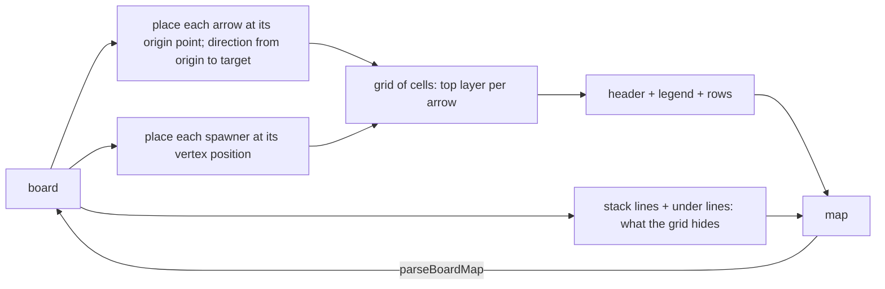

# agent-board-map — the whole board for the agent seat

**Packet:** [P93 — The agent can see the whole board](../../design/packets/P93-agent-board-map.md)
**Builds on:** [remote-agent-mcp](../remote-agent-mcp/remote-agent-mcp.md) (P92; this spec replaces its result shape), the BYOK seat (`packages/web/src/byokBot.ts`), [ADR 0009](../../adr/0009-remote-agent-mcp-seat.md).
**SPEC:** none. No game rule. Nothing is owed to SPEC §11.
**Features:** [core](./agent-board-map.core.feature) · [edge cases](./agent-board-map.edge-cases.feature) · [message flows](./SCENARIOS.md)

The P92 offer is built to be small. Territory is a count, spawners are capped
at 12 rows, trails are a 24-arrow sample. In the 2026-11-14 smoke test that
left the agent unable to see borders or the open spawners in the centre. This
feature adds an opt-in `board` argument to `observe` and `move` that returns
the whole board as JSON, as a text map drawn by the door, or both. The map is
a pure renderer in the shared offer package, also behind `pnpm board-map`.
The map is honest: `parseBoardMap` reads every fact of the board back from
it, and a property test proves the round trip.

## Terms

| Term | Means |
|---|---|
| **`board` argument** | the optional `board` argument of `observe` and `move`: `"off"` (default), `"json"`, `"ascii"`, or `"both"` |
| **board** | the `board` object `"json"` and `"both"` add beside `offer`. Ids, not counts. Defined below |
| **map** | the text `boardMap(board)` returns, and the second content block `"ascii"` and `"both"` add. Defined below |
| **board-bearing result** | a tool result that carries an offer: `observe` on this seat's turn, or a `move` with `stop: false` |
| **JSON block** | the first text content block of a tool result: machine fields as JSON |
| **offer block** | the text content block after the JSON block that holds the offer text, real newlines |
| **cell width** | the characters per map column, `W`. At least `3S + 2` |
| **slot width** | the characters per arrow in a point cell, `S`: the longest arrow glyph on the board, at least 1 |
| **point cell** | the `W` characters of the map that draw one point's three out-arrows, centred |
| **vertex cell** | the `W` characters of the map between point cells, where spawners are drawn |
| **arrow glyph** | what an arrow's slot shows: its top layer (stack, else trail, else territory, else `.`) |
| **hidden layer** | a trail or territory under an arrow's glyph; listed on an `under` line |
| **spawner label** | a spawner's three thirds (holder letters, `o` unclaimed) followed by its force, written from the fraction: `d` for `1/d`, else `n/d` |
| **representable board** | a board `boardMap` can draw exactly (see [What the map refuses](#what-the-map-refuses)) |
| **`pnpm board-map`** | the CLI. Reads a board, or an observe result carrying one, from a file argument or stdin. Prints the map |

## Where the code lives (BSSN)

- **`@conquarrow/byok-offer`** (`src/board.ts`): `boardView(geometry, state, me)`,
  `boardMap(board)`, `parseBoardView(json)`, `parseBoardMap(text)`. Pure: no clock, no I/O. The
  group rows and spawner rows are the same helpers `snapshotForPrompt` uses,
  so a `board.groups` row and a `STATE_JSON.groups` row cannot drift apart.
- **MCP door** (`packages/online-api/src/mcp-door.ts`): `observe` and `move`
  read `board`, add the `board` key and the map block to a board-bearing
  result, and document `board` in `tools/list`. Nothing else in the door
  changes.
- **CLI**: `scripts/board-map.mjs` (vite-node launcher, same shape as
  `pnpm bots`) and `scripts/board-map-run.ts` (read input, parse, print).
  No logic beyond I/O.

## The board

```json
{
  "me": "B",
  "players": ["A", "B", "C"],
  "activePlayer": "B",
  "territory": { "A": ["tiling:a:…"], "B": [], "C": ["…"] },
  "trails": { "A": [], "B": [], "C": ["…"] },
  "groups": [{ "arrow": "…", "owner": "C", "heads": 2, "spent": 0, "speed": 2 }],
  "spawners": [{ "vertex": "tiling:v:…", "force": "1/5", "held": { "B": 3 }, "unclaimed": 0 }]
}
```

- `territory` and `trails` have one key per seat in `players` order, each a
  list of arrow ids sorted ascending. A seat with none has `[]`. An owner
  that is not in `players` follows the seats, in id order, so no arrow is
  dropped.
- `groups` is every stack, in the `STATE_JSON.groups` row shape, sorted by
  arrow id (`speedOverride` only when set).
- `spawners` is every spawner on the board, sorted by vertex id. `held` maps
  a seat to how many of the 3 bordering arrows it holds as territory;
  `unclaimed` is the rest. Same row shape as `STATE_JSON.spawners`.
- `force` is the spawner's force as the `n/d` string of its fraction, the
  same as `STATE_JSON.spawners`. No value is special.
- The board is of the same position as the offer block beside it.

## Result blocks

Every board-bearing result is text content blocks, in this order:

1. **JSON block**: the machine fields. `observe`: `{ stop: false, blocks }`.
   `move`: `{ applied: true, version, stop: false, blocks }`, or `{ stop:
   false, blocks }` for an empty reply. Plus `board` when asked. No `offer`
   key. `blocks` names the text blocks that follow, in order: `["offer"]`
   or `["offer", "map"]`.
2. **Offer block**: `offerText` of that state and seat, as is.
3. **Map block**, when `board` asks for it: `boardMap` of the board.

A stop result and an error result are one JSON block, as in P92. Nothing a
model reads is an escaped string inside JSON. This revises P92's `{ stop:
false, offer }` and `{ applied, version, stop: false, offer }`; P92's spec
links here.

## One agent context: the door and the BYOK seat

`agentContext(offer, geometry, state, seat, board)` in
`@conquarrow/byok-offer` builds what a model sees for a turn:

| `board` | `offer` | `board` (JSON) | `map` |
|---|---|---|---|
| `"off"` | the offer | — | — |
| `"json"` | the offer | `boardView` | — |
| `"ascii"` | the offer | — | `boardMap(boardView)` |
| `"both"` | the offer | `boardView` | `boardMap(boardView)` |

- **The door** passes `offerText` and the caller's `board`, and writes the
  context as result blocks (above).
- **The web BYOK seat** passes the prompt it built (`buildUserPrompt`: the
  offer with its target locks and plan echo) and `"ascii"` on the first
  request of each seat-turn, `"off"` on later requests of that seat-turn.
  It sends `agentPromptText(context)` as the `user` message:

  ```text
  BOARD_MAP (whole board; legend in the system prompt and at the top of the map):
  map me=B active=B players=A,B,C; 11 characters per column, 2 per arrow.
  …
  stack …
  under …

  Seat B. Return an ordered moves index array …
  ```

  With no map the user message is the offer alone. With a board JSON (no
  BYOK path asks for one) a `BOARD_JSON:` section precedes the map.
- The BYOK system prompt ends with a short note on `BOARD_MAP` and the map
  legend, `MAP_LEGEND`, the same text the map prints and the MCP `board`
  description quotes.
- The map is drawn on the generated tiling only (decision 8); the web game
  and the door play on it.

## The `board` argument

| `board` | Content blocks of a board-bearing result |
|---|---|
| missing or `"off"` | 2: the JSON block; the offer block |
| `"json"` | 2: the JSON block with a `board` key; the offer block |
| `"ascii"` | 3: the JSON block; the offer block; the map block |
| `"both"` | 3: the JSON block with a `board` key; the offer block; the map block |

- The JSON block is always first and parses alone. The offer and the map are
  never inside JSON: an escaped string does not read as text or as a grid.
- A stop result and an error result are unchanged by `board`: one block, no
  board, no map.
- Any other value (a string not in the four, a boolean, a number, `null`)
  is `isError` with `{ error, stop: false }`, `error` naming the four values.
  It is checked before the invite is read: nothing is read, applied or
  written.

## Tool descriptions

`tools/list` is the agent's only manual. On both `observe` and `move` the
`board` property is `{ type: "string", enum: ["off", "json", "ascii",
"both"], default: "off" }` and not required. Its description, the same on
both tools, says:

- what each value returns, and that the map comes as its own text block
  after the offer block;
- the cost: on the smoke-test position the offer is about 6 KB, the map
  about 7 KB, the board JSON about 9 KB, and `"both"` is the sum;
- when to use it: `"ascii"` once at the start of a turn to see borders,
  fronts and far spawners; `"json"` when exact ids are needed beyond the
  offer; `"off"` for the rest of the turn;
- the map legend: `MAP_LEGEND`, the same text the map prints.

The `observe` and `move` tool descriptions name `board` and point at that
property, and say the result blocks: the JSON block, then the offer as plain
text, then the map if asked. `move`'s says the board is of the position after
the move. The force notation is described from the fraction, with no list of
forces.

## The map



Positions come from the generated tiling's layout (`makeLayout()`), the one
the browser draws:

- A point at layout position `(x, y)` sits at **row** `round(-2y)` and
  **column** `round(x / (√3/2))`. For tiling point `(i, j)` that is row
  `2i + j`, column `j`. Up on the screen is a larger row. Rows print top
  (largest) to bottom.
- A cell whose row and column have the same parity is a **point cell**; the
  other cells are **vertex cells**.
- A point cell draws that point's three out-arrows as three **slots** of
  `S` characters each, one space between slots, centred in the cell
  (`floor((W - 3S - 2) / 2)` spaces before), ordered by where the arrow points on screen: **left** =
  down-left, **middle** = up, **right** = down-right. On the tiling those
  are `tiling:a:i,j,2`, `…,0`, `…,1`. A glyph shorter than `S` is padded
  with spaces on its right.
- An arrow's **glyph** is its top layer: a stack as its owner's seat letter
  then its exact head count (`B3`, `C12`); else a trail as the seat letter
  in upper case (`B`); else territory as the seat letter in lower case
  (`a`); else `.`. A stack is above a trail, a trail above territory. When
  two seats' trails share an arrow, the first seat letter is the glyph.
- `S` is the longest glyph on the board: 1 with no stacks, 2 with stacks of
  1-9 heads, 3 with 10-99 heads, and so on. No count is abbreviated.
- A spawner sits in the vertex cell at its layout position, rounded the same
  way: in the cell's **left** part, left-aligned, when its position is left
  of the column centre, else in the **right** part, right-aligned. The left
  part is `floor((W - 1) / 2)` characters, then one space, then the right
  part.
- A **spawner label** is its three thirds, then its force. Thirds: one
  lower-case holder letter per third that seat holds, seats in letter
  order, then `o` per unclaimed third (`ooo` open, `bbo`, `abc`). Force: `d`
  when the force is `1/d`, else `n/d`, from the fraction alone (`1/5` is
  `5`, `2/7` is `2/7`). So `ooo5` is open with force 1/5 and `bbo2/7` is two
  thirds held by B, one open, force 2/7. A vertex cell with no spawner is
  spaces.
- `W` is the larger of `3S + 2` and `2L + 1`, where `L` is the longest spawner
  label on the board. It comes from the data only.
- The grid covers the smallest row and column range holding every listed
  arrow's origin point and every spawner.
- Output lines, in order:
  1. the header: `map me=B active=B players=A,B,C; 11 characters per column, 2 per arrow.`;
  2. the `MAP_LEGEND` lines;
  3. a column-label line, then one line per row (`row` right-aligned in 3,
     a space, then the cells);
  4. one `stack <seat><heads> <arrow> spent <n> speed <n>` line per stack,
     with ` override <n>` when it has a `speedOverride`, sorted by owner
     then arrow; `stacks: none` when there is none;
  5. one `under <arrow> <layers>` line per arrow whose glyph hides a layer,
     sorted by arrow id: the hidden layers bottom first, the territory
     owner in lower case, then trail owners in upper case (`under
     tiling:a:0,0,0 aB`: under the glyph are A's territory and B's trail);
     `under: none` when nothing is hidden.

  Trailing spaces are trimmed. Lines end with `\n`.

### Reading a map back

`parseBoardMap(text)` reads a map back to its board. It uses the stated
layout only (row `2i + j`, column `j`, the slot order, the vertex-cell
sides), not the layout code, so it is an independent check of `boardMap`.
The board it returns is **normalized**: `players`, `me`, `activePlayer`
from the header; `territory` and `trails` with one key per seat in
`players` order, then any other owner in letter order, each list sorted;
`groups` sorted by arrow; `spawners` sorted by vertex. Text that is not a
map throws a `ContractViolation`.

For every representable board `b`, `parseBoardMap(boardMap(b))` equals `b`
normalized. Nothing the board says is lost: not who owns a stack, not a
count of 10 or more, not a trail or territory under a stack, not who holds
which third of a spawner, not `spent`, `speed` or `speedOverride`.

### What the map refuses

`boardMap` throws a `ContractViolation` naming the problem, rather than
draw a map it cannot read back, for:

- an id that is not a canonical arrow or vertex id of the generated tiling
  (a fixture-board id, `tiling:a:01,2,0`);
- a seat, owner or holder that is not one letter `A`-`H` (a game has at
  most 8 seats, so `o` never names a seat);
- an arrow in two seats' territory, an arrow twice in one list, two stacks
  on one arrow, or one vertex twice;
- a spawner whose held counts are not positive integers, or whose held
  counts plus `unclaimed` are not 3;
- a force that is not `n/d` in digits.

A sample, from the smoke-test fixture, is the golden file
[`smoke-2026-11-14.map.txt`](../../../packages/byok-offer/test/fixtures/smoke-2026-11-14.map.txt).
Its board is [`smoke-2026-11-14.board.json`](../../../packages/byok-offer/test/fixtures/smoke-2026-11-14.board.json),
so `pnpm board-map packages/byok-offer/test/fixtures/smoke-2026-11-14.board.json`
prints it without a server.

## Decisions (BSSN)

Recorded in the [packet](../../design/packets/P93-agent-board-map.md#decisions-bssn-settled-with-the-human-2026-11-14):
one `board` enum on `observe` and `move`; any other value is a correctable
error; a board only beside an offer; no summary lines; the door draws the map
too, as its own content block; spawner force on the map; the tool
descriptions teach `board`; tiling only; an honest, reversible map (decisions 16-20). Two more made here:

- **`parseBoardView` is strict on shape.** It accepts a board, or an object
  with a `board` key holding one. It returns `undefined` for anything
  missing `me`, `players`, `territory`, `trails`, `groups` or `spawners`, or
  whose lists are not lists. The CLI prints a one-line error and exits 1.
- **The fixture is rebuilt, not copied.** The browser's export of the
  2026-11-14 game omits the heuristic seat's moves and the agent's
  `endTurn`s (backlog item). The fixture re-runs seat A with the production
  chooser, inserts the missing `endTurn`s, checks every move legal, and ends
  with B to move. It is a real, reachable position close to the human's
  screenshots, not a byte copy of the online log.

## Invariants

1. When a board-bearing result has `board` `"json"` or `"both"`, the system shall list every territory arrow of the position exactly once, under its owner.
2. When a board-bearing result has `board` `"json"` or `"both"`, the system shall list every trail arrow of every seat, with no sample cap.
3. When a board-bearing result has `board` `"json"` or `"both"`, the system shall list every spawner, and for each one the held shares plus `unclaimed` shall equal 3.
4. When `board` is missing or `"off"`, the system shall return the JSON block and the offer block only, with no `board` key.
5. When a board-bearing result has `board` `"ascii"` or `"both"`, the system shall return a map block, after the offer block, equal to `boardMap` of that position's board.
6. If `board` is not one of the four values, then the system shall return a correctable error and shall not read, apply or write anything.
7. The system shall render the same map for the same board, whatever the order of its lists.
8. The system shall draw every listed arrow in its origin point's cell, at the slot its direction names, with the glyph of its top layer, and shall list every layer under that glyph on an `under` line.
9. The system shall draw every spawner exactly once, as its three thirds and force, in one side of one vertex cell, for any force fraction and any split of its thirds.
10. When a result carries an offer, the system shall return it as its own text block equal to `offerText` of that state and seat, and no JSON block shall have an `offer` key.
11. On the first request of a BYOK seat-turn, the system shall send as the `user` message `agentPromptText` of `agentContext` with `"ascii"` for that state and seat, whose map equals the door's map block for the same state and seat.
12. On a later request of the same BYOK seat-turn, the system shall send the offer without a map.
13. The system shall use `MAP_LEGEND` as the legend in the map, in the MCP `board` description and in the BYOK system prompt.
14. For every representable board, `parseBoardMap(boardMap(board))` shall equal the board normalized.
15. The system shall draw distinct arrows at distinct (row, column, slot) places, and distinct vertices at distinct (row, column, side) places.
16. If a board is not representable, then `boardMap` shall throw a `ContractViolation` naming the problem and shall draw nothing.

## Counts

- Core scenarios: 16. Edge-case scenarios: 21 (five outlines). Invariants: 16.
- Flows in [SCENARIOS.md](./SCENARIOS.md): 2 (observe with board, move with board).
