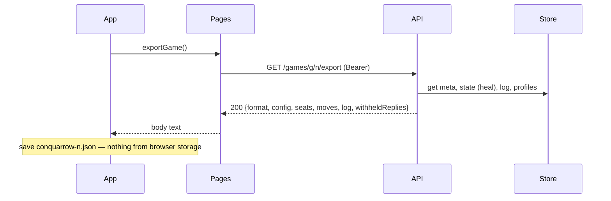
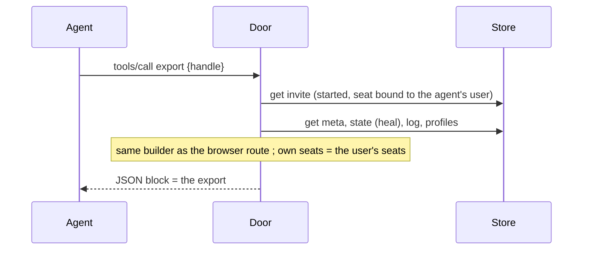
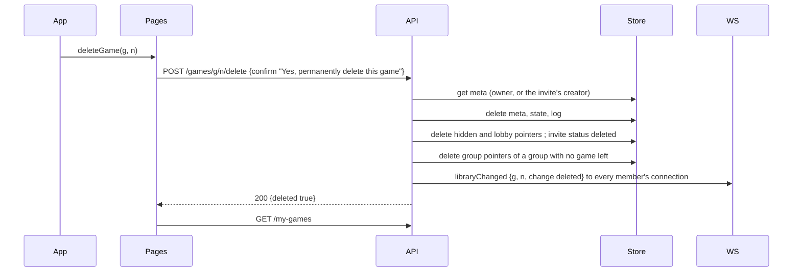
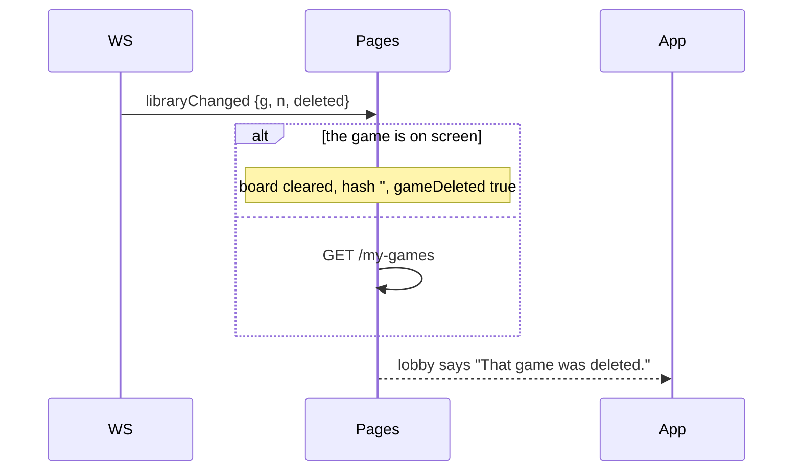
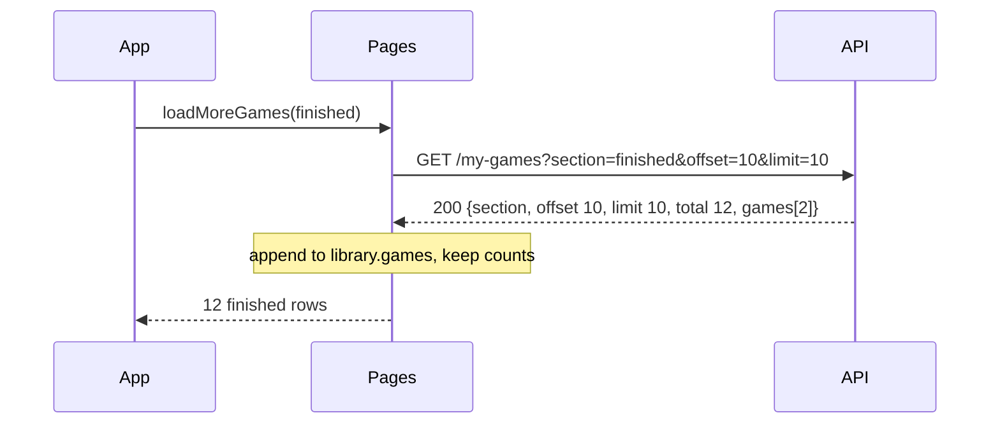

# game-management — sequence diagrams

Participants are the seams the tests probe: **App** (the port's caller),
**Pages** (`createOnlinePages`), **API** (`createOnlineApi`, or the injected
`fetch` in web tests), **Door** (`handleMcpHttp`), **Store** (the object store)
and **WS** (post to connection). [Overview](./game-management.md).

## 1. Download log in an online game

## 2. The agent exports over MCP

## 3. The owner deletes a game

## 4. Another member's screen learns the game is gone

## 5. Show more in a section

