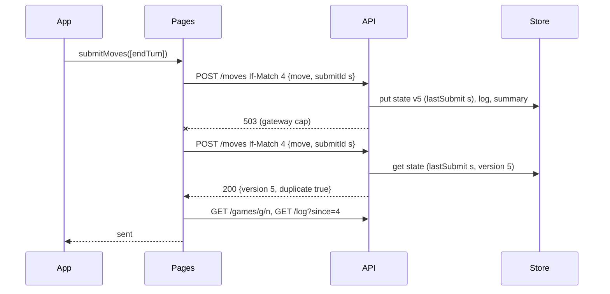
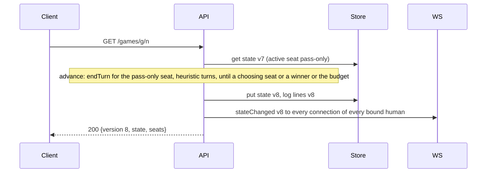
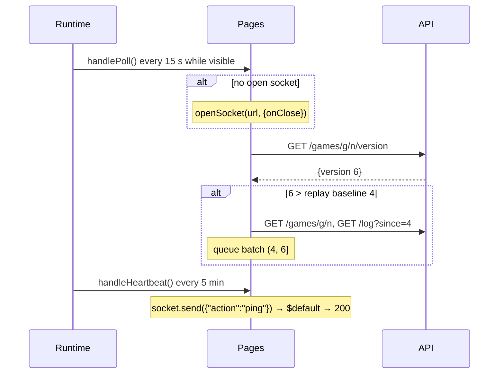
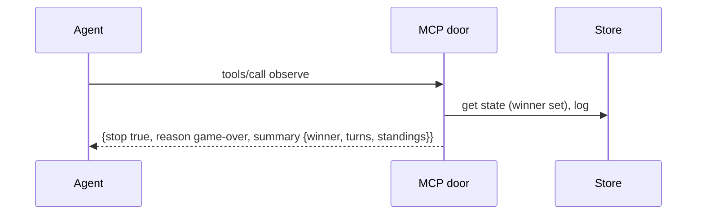

# online-reliability — sequence diagrams

Participants are the seams the tests probe: **App** (the port's caller),
**Pages** (`createOnlinePages`), **API** (`createOnlineApi`, or the injected
`fetch` in web tests), **Store** (the object store) and **WS** (post to
connection). [Overview](./online-reliability.md).

## 1. A gateway timeout, then the retry is a duplicate



## 2. A 401 holds the submit until the next credential

```mermaid
sequenceDiagram
  participant App
  participant Pages
  participant API
  App->>Pages: submitMoves([endTurn])
  Pages->>API: POST /moves {submitId s}
  API-->>Pages: 401
  Note over Pages: held = {moves, ids, version}; pending true; gis.prompt()
  Pages-->>App: unauthorized (note: sign in and it will be sent)
  App->>Pages: deliverGoogleCredential(token)
  Pages->>API: POST /moves {submitId s}
  API-->>Pages: 200 {version 5}
  Pages->>API: GET /games/g/n (reconcile)
  Note over Pages: held cleared; pending false
```

## 3. The advance passes a lost seat and heals on read



## 4. The poll is the fallback for a dead socket



## 5. Game over


